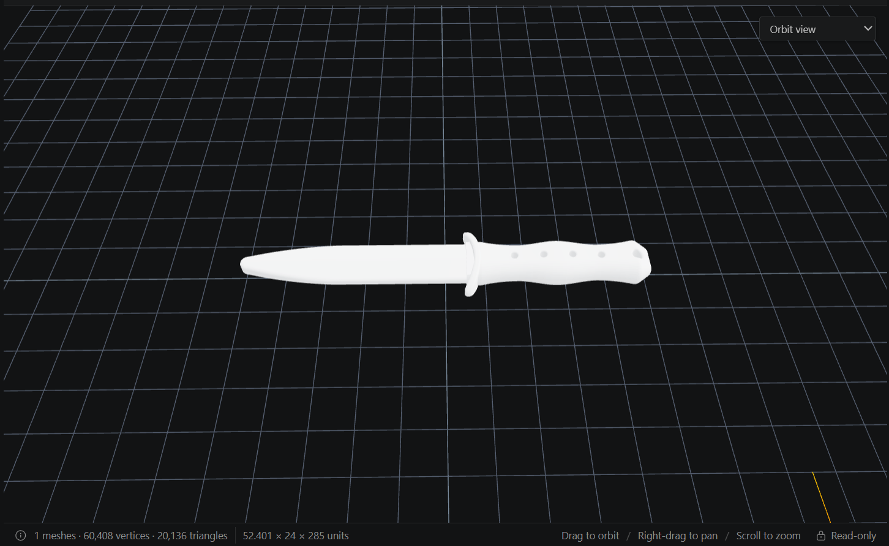
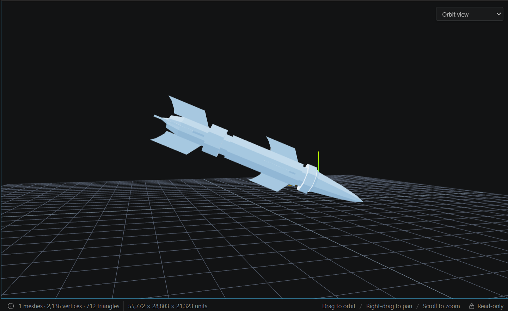

# 🎨 Proyecto 6: Detector de Armas con Modelo 3D

## 📋 Descripción del Proyecto

Sistema funcional para la detección de armas y su representación/análisis en modelos 3D mediante álgebra lineal funcional, operaciones CSG (Constructive Solid Geometry), transformaciones composables y exportación a formatos estándar (STL, OBJ).

- **Institución:** Universidad de Colima - Ingeniería en Computación Inteligente
- **Materia:** Programación Funcional
- **Profesor:** Gonzalez Zepeda Sebastian
- **Semestre:** Agosto 2026 - Enero 2027

---

## 🎯 Objetivos

- Implementar **álgebra lineal funcional** (vectores, matrices, transformaciones) para extraer proporciones espaciales y dimensiones reales que permitan **distinguir tipos de armas** (armas cortas, armas largas, objetos punzocortantes) frente a objetos cotidianos.
- Desarrollar **operaciones CSG** puras (`union`, `difference`, `intersection`) para comparar la silueta volumétrica de un objeto detectado contra plantillas 3D de referencia y calcular su grado de coincidencia.
- Crear **curvas y superficies** mediante funciones paramétricas para modelar contornos característicos (cañones, empuñaduras, hojas metálicas) que faciliten la clasificación geométrica.
- Aplicar **transformaciones composables** (rotación, traslación, escala) para normalizar la orientación y escala de cualquier objeto detectado antes de evaluarlo.
- Generar **meshes 3D** de los objetos clasificados mediante funciones puras.
- Exportar los modelos 3D identificados y etiquetados en formatos estándar (STL, OBJ).

---
## 🧠 Paradigma de Programación Funcional Aplicado

El sistema está diseñado sin mutación de estado ni efectos secundarios dentro de su núcleo lógico:

- **Inmutabilidad:** Los vértices `(x, y, z)`, triángulos y mallas completas se modelan exclusivamente mediante tuplas inmutables (`tuple`).
- **Composición de Funciones (`compose`):** Las transformaciones afines (traslación al origen, alineación de eje principal y escalado uniforme) se encadenan como funciones puras aplicadas mediante `map()`.
- **Representación Funcional de Sólidos (SDF):** Cada objeto 3D se transforma en una función pura $f(x, y, z) \rightarrow \mathbb{R}$ (Campo de Distancia con Signo), permitiendo implementar operaciones booleanas CSG exactas (`union`, `intersection`, `difference`) como combinadores de orden superior.

---


## 📂 Estructura del Proyecto

```text
Generador_de_Modelos_3D_Parametricos/
├── 3D_assets/                                # Modelos 3D de referencia por categoría (.stl)
│   ├── Arma_corta.stl                        # Plantilla de arma corta
│   ├── Arma_larga.stl                        # Plantilla de arma larga
│   ├── kunai.stl                             # Plantilla de objeto arrojadizo / kunai
│   ├── Misil.stl                             # Plantilla de proyectil / misil
│   ├── Navaja.stl                            # Plantilla de objeto punzocortante / navaja
│   ├── Revolver.stl                          # Plantilla de revólver
│   └── Tiro.stl                              # Plantilla de munición / proyectil
├── docs/                                     # Documentación técnica y matemática del sistema
│   ├── api_guide.md                          # Guía de referencia de funciones puras y módulos
│   ├── como_funciona_el_codigo.md            # Explicación del flujo y arquitectura funcional
│   └── referencia_matem_tica_y_geom_trica.md # Fundamentos de álgebra lineal, curvas y CSG
├── input_analizar/                           # Carpeta de entrada para el modelo 3D a evaluar
│   └── objeto_desconocido.stl                # Archivo de prueba sin clasificar
├── output_clasificados/                      # Salida con mallas normalizadas y etiquetadas (.stl / .obj)
├── src/                                      # Código fuente bajo el paradigma de Programación Funcional
│   ├── algebra_lineal.py                     # Estructuras inmutables y operaciones vectoriales/matriciales 4x4
│   ├── clasificador.py                       # Evaluación de similitud espacial (Bounding Box) y volumétrica (CSG)
│   ├── csg.py                                # Operaciones booleanas 3D puras (union, intersection, difference) con SDF
│   ├── geometria_parametrica.py              # Curvas de Bézier y superficies paramétricas (cañones, empuñaduras, hojas)
│   ├── io_meshes.py                          # Lectura pura de STL (ASCII/binario) y exportación a STL y OBJ
│   ├── main.py                               # Orquestador y pipeline funcional de ejecución
│   └── transformaciones.py                   # Composición de funciones (compose) y normalización de orientación/escala
├── .gitignore                                # Exclusión de archivos temporales (__pycache__, etc.)
├── README.md                                 # Documentación general del proyecto
└── requirements.txt                          # Dependencias del entorno (librería estándar de Python)
```

---

## ⚙️ Instalación y Uso

### Requisitos Previos
- **Python 3.10 o superior** (el proyecto utiliza únicamente la librería estándar: `math`, `struct`, `pathlib`, `functools` y `typing`, sin dependencias externas).

### Ejecución Paso a Paso

1. **Clonar el repositorio:**
   ```bash
   git clone https://github.com/sebastiangz/Generador_de_Modelos_3D_Parametricos.git
   ```

3. **Entrar al directorio del proyecto:**
   ```bash
   cd Generador_de_Modelos_3D_Parametricos
   ```
4. **Colocar el modelo a evaluar:**
   Guarda cualquier archivo `.stl` (en formato ASCII o Binario) dentro de la carpeta `input_analizar/`.

5. **Ejecutar el pipeline de análisis:**
   ```bash
   python src/main.py
   ```

6. **Revisar resultados:**
   - La clasificación y los porcentajes de coincidencia se mostrarán en la consola.
   - La malla 3D normalizada y etiquetada se exportará automáticamente en formatos `.stl` y `.obj` dentro de `output_clasificados/`.

---

## 📊 Ejemplo de Salida en Consola

```text
Archivo analizado: objeto_desconocido.stl
  - Similitud con Arma_corta: 100.00%
  - Similitud con Arma_larga: 29.64%
  - Similitud con kunai: 39.03%
  - Similitud con Misil: 42.16%
  - Similitud con Navaja: 35.62%
  - Similitud con Revolver: 51.62%
  - Similitud con Tiro: 31.08%
Resultado final: ARMA_CORTA
```

> **Nota sobre extensibilidad:** 
Puedes agregar nuevas categorías de comparación simplemente depositando archivos `.stl` adicionales dentro de `3D_assets/`; el sistema los detectará e indexará automáticamente en la siguiente ejecución.

---

## 🖼️ Vista Previa de Modelos 3D (Visor STL)

Visualización en visor 3D de las mallas analizadas, normalizadas y exportadas en formato `.stl` por el sistema:

| Arma Corta (`Arma_corta.stl`) | Objeto Punzocortante (`Navaja.stl`) | Arma Larga (`Misil.stl`) |
| :---: | :---: | :---: |
|  |  |  |

## 📚 Material

---

- **Repositorio de Modelos 3D de Referencia (Creality Cloud):** https://www.crealitycloud.com/pt *(Fuente utilizada para obtener las mallas 3D base en formato STL/OBJ de armas cortas, largas y objetos de comparación)*.